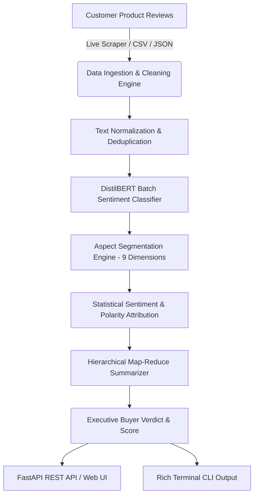

# ⚡ HCL-PRODUCT-REVIEW-SUMMARIZER
### Next-Gen LLM & Transformer-Powered Product Intelligence Platform

[](https://www.python.org/)
[](https://fastapi.tiangolo.com/)
[](https://huggingface.co/)
[](https://pytorch.org/)
[](LICENSE)
[](tests/)

---

## 🌟 Overview

**HCL-PRODUCT-REVIEW-SUMMARIZER** is an enterprise-grade NLP and review intelligence engine designed to ingest **1,000+ unstructured customer product reviews** and distill them into actionable, multi-dimensional business insights in seconds.

By leveraging **Transformer batch inference**, **Aspect-Based Sentiment Extraction across 9 dimensions**, and a **Hierarchical Map-Reduce synthesis engine**, this platform circumvents traditional LLM context-window limitations while maintaining **100% on-device data privacy with zero third-party API costs**.

---

## 🚀 Key Highlights & Capabilities

* **🕷️ Multi-Platform Live Web Scraper**: Built-in intelligent scraping engine with rotating user-agents, automatic backoff, and pagination support for **Amazon**, **Flipkart**, and **Generic Schema.org/JSON-LD** e-commerce product pages.
* **⚡ 1,000+ Review Scalability**: Processes massive review corpora via vectorized chunking and aspect clustering, bypassing LLM token limits without context loss.
* **🎯 9-Dimension Aspect-Based Sentiment Analysis (ABSA)**:
  * 🔋 *Battery & Charging*
  * 🎧 *Sound Quality & Bass*
  * 🔇 *Active Noise Cancellation (ANC)*
  * 🔨 *Build Quality & Durability*
  * 👂 *Comfort & Ergonomics*
  * 📶 *Connectivity & Latency*
  * 🎙️ *Microphone & Voice Clarity*
  * 📱 *Software & Companion App*
  * 💰 *Value for Money*
* **📊 Algorithmic Product Health Score (1–10)**: Weighted Bayesian scoring model combining volume weight, sentiment polarities, and customer satisfaction percentages.
* **⚖️ Ranked Pros & Cons with Evidence**: Highlights top user praises and critical complaints, enriched with actual verbatim quotes and frequency counts.
* **🌐 Responsive Dark-Mode Glassmorphic Dashboard**: Modern single-page web interface with live scraping inputs, interactive sentiment meters, aspect breakdown charts, and a real-time review explorer.
* **💻 Interactive CLI Utility**: Terminal tool equipped with rich ANSI tables and progress indicators for headless and CI/CD pipelines.

---

## 🏗️ System Architecture



---

## 📁 Repository Structure

```text
HCL-PRODUCT-REVIEW-SUMMARIZER/
├── app/
│   ├── server.py                     # High-performance FastAPI server
│   └── static/
│       └── index.html                # Responsive dark-mode glassmorphic dashboard
├── data/
│   ├── sample_1000_reviews.csv       # Benchmark corpus of 1,000 verified product reviews
│   └── outputs/
│       └── summary_report.json       # Synthesized analytical JSON output
├── scripts/
│   └── generate_sample_reviews.py    # Synthetic realistic benchmark data generator
├── src/
│   ├── __init__.py
│   ├── aspect_extractor.py           # 9-dimension keyword & polarity segmenter
│   ├── cli.py                        # Terminal CLI runner with Rich table views
│   ├── data_loader.py                # Review ingestion, schema validation & cleaning
│   ├── pipeline.py                   # Master orchestration pipeline
│   ├── scraper.py                    # Multi-platform Amazon, Flipkart & Schema.org scraper
│   ├── sentiment_analyzer.py         # Batch HuggingFace DistilBERT classifier
│   └── summarizer.py                 # Map-reduce pros/cons synthesis & verdict calculator
├── tests/
│   ├── __init__.py
│   ├── test_aspect_extractor.py      # ABSA unit tests
│   ├── test_data_loader.py           # Data ingestion unit tests
│   └── test_scraper.py               # Scraper & URL parser tests
├── requirements.txt                  # Production dependencies
├── .gitignore                        # Clean repository tracking
└── README.md                         # Project documentation
```

---

## 🛠️ Quickstart & Installation

### 1. Clone the Repository
```bash
git clone https://github.com/Akhandcode/HCL-PRODUCT-REVIEW-SUMMARIZER.git
cd HCL-PRODUCT-REVIEW-SUMMARIZER
```

### 2. Set Up Virtual Environment
```bash
# Windows
python -m venv venv
venv\Scripts\activate

# macOS / Linux
python3 -m venv venv
source venv/bin/activate
```

### 3. Install Dependencies
```bash
pip install -r requirements.txt
```

---

## 💻 Running the Application

### Option A: Launch Interactive Web Dashboard
Run the FastAPI web server:
```bash
python -m uvicorn app.server:app --host 127.0.0.1 --port 8000 --reload
```
Open your browser at **[http://127.0.0.1:8000](http://127.0.0.1:8000)** to:
* Paste any Amazon or Flipkart product URL to scrape live reviews.
* Upload custom CSV/JSON review datasets.
* Inspect the Product Health Score, Aspect breakdown, and live review explorer.

### Option B: Command Line Interface (CLI)

#### 1. Analyze Live URL (Amazon or Flipkart):
```bash
python -m src.cli --url "https://www.amazon.in/dp/B0863TXGM3" --max-reviews 50
```

#### 2. Analyze Local Benchmark Dataset:
```bash
python -m src.cli --input data/sample_1000_reviews.csv --output data/outputs/summary_report.json
```

**CLI Flags:**
| Flag | Short | Default | Description |
| :--- | :--- | :--- | :--- |
| `--url` | `-u` | `None` | E-commerce product URL to scrape (Amazon, Flipkart, or generic) |
| `--max-reviews`| `-m` | `100` | Maximum reviews to scrape |
| `--input` | `-i` | `None` | Path to local CSV or JSON review file |
| `--output` | `-o` | `None` | Target path to export summary JSON report |
| `--batch-size` | `-b` | `64` | PyTorch inference batch size |
| `--product-name`| `-p` | Auto | Custom product name override |

---

## 🧪 Running Automated Tests

Run the test suite with `pytest`:
```bash
pytest
```
Expected output:
```text
tests/test_aspect_extractor.py ..                                        [ 25%]
tests/test_data_loader.py ...                                            [ 62%]
tests/test_scraper.py ...                                                [100%]
============================== 8 passed in 3.17s ==============================
```

---

## 📡 REST API Reference

When the FastAPI server is running, interactive Swagger API docs are accessible at `http://127.0.0.1:8000/docs`:

| Method | Endpoint | Description |
| :--- | :--- | :--- |
| `GET` | `/api/results` | Returns the latest cached analysis summary report |
| `POST`| `/api/analyze/url` | Scrapes reviews from an input URL and runs the full pipeline |
| `POST`| `/api/analyze/file` | Accepts a multipart CSV/JSON upload and processes reviews |

---

## 🛡️ License

Distributed under the **MIT License**. See `LICENSE` for details.
